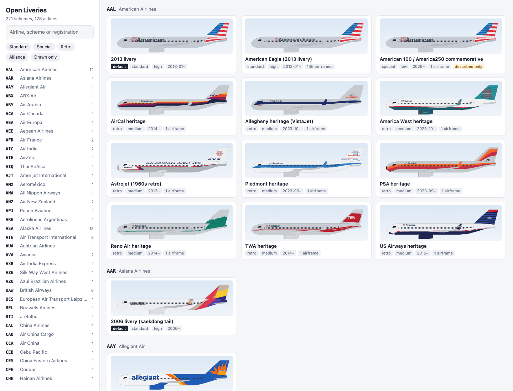
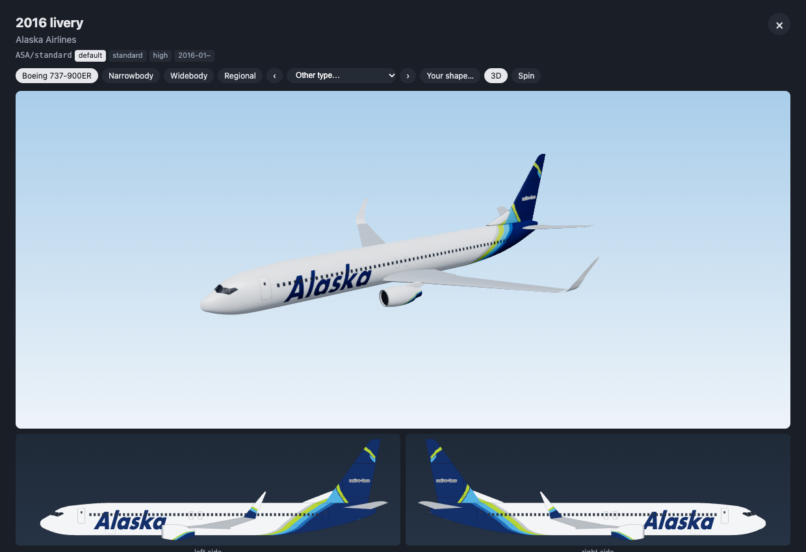

# Open Liveries viewer

A browser of the whole dataset on a computer or a phone ([live](https://majonesmax.github.io/open-liveries/)). It
has search and filters. Each scheme shows in 3D and drawn from both sides and from below by the
[renderer](../../renderer/README.md). It's drawn on the type it was measured on where `shapes/` has it (the 737-800,
the A320), or else on a narrowbody, widebody or regional jet. Each one also lists its parts, titles, logos, palette,
sources and the airframes that wear it. An airline that flies jets in another's paint lists those schemes too, under
"Also flies in" (Sun Country's Prime Air freighters, SkyWest's Express, Connection and Eagle jets). Its drawing was
first written from the JSON and [docs/COORDINATES.md](../../docs/COORDINATES.md) alone as a test that the docs are
enough. It has since moved into the renderer.



## In 3D

A scheme's panel opens on a three.js aircraft built from the shape it's drawn on. That's a measured type from
`shapes/`, a built-in shape or your own shape's JSON (**Your shape…**). Drag to turn it and scroll to zoom. **Spin**
stops or starts it and **3D** hides it (remembered). ‹ and › (or the arrow keys) step through the measured types,
the 3D model and the drawings together. three.js 0.170 comes from jsDelivr through the page's import map and loads
only when a panel first shows the model. `examples/three-demo/` sends its old links here.



- `src/three/measured-model.ts` builds a measured type from its lines (docs/SHAPES.md). The fuselage is lofted
  round its crown, belly and half-width. The fin has its fillet. Wings, tailplane and wingtip devices sit between
  their measured edges at their heights. Nacelles are turned round their top and bottom.
- `src/three/model.ts` builds the aircraft from a built-in shape. It lofts round `fuselageProfile` wearing
  `renderTexture(scheme, 'fuselage')` and gives the fin a face each way wearing that side's `renderTexture(scheme,
'fin')` through `sideProjection`. Wings, tailplane and engines are in the scheme's colors.
- `src/three/parts.ts`: the airfoil wings (closed at their tips), nacelles (wearing `renderTexture(scheme, 'engine')`) and pylons both use.
- `src/three/view3d.ts`: the textures (SVG to a canvas), the scene, the controls and the camera.

See _In 3D_ in the renderer's README for the texture layouts. To put a scheme on your own model, give its
fuselage the same texture coordinates (along it and round it from the belly up the left side) and its fin the side
view's projection.

## Run it

The viewer reads `index.json` and the dataset's files from the repository root, so serve the root:

```sh
python3 -m http.server 8000      # from the repository root
open http://localhost:8000/examples/svg-viewer/
```

After changing schemes or airframes, rebuild the index with `tools/index.py`.

URLs: `?q=alaska` keeps a search, `#ASA/standard` opens a scheme, `#air-ASA` scrolls to an airline.
`?shape=A359` (a measured type's id) or `?shape=widebody` draws on that shape. `?angle=180&elevation=-20` starts
the 3D camera that many degrees round and up and stops the spin. `&zoom=3` starts it three times closer.
`&look=4,1,17` points it at that spot in meters from the aircraft's middle (along, up, out to its left).

## Develop

The sources are TypeScript in `src/`. `tsc` compiles them to plain ES modules in `js/`, and **the compiled
`js/` is committed**. So the site is static files. GitHub Pages or any file server serves it as it is, with no
build step, bundler or runtime dependencies. three.js for the 3D view comes from a CDN. Rebuild and commit `js/`
with every source change.

From the repository root (Node 20 or later):

```sh
npm install          # dev tools only: TypeScript, ESLint with typescript-eslint, Prettier, Node's types
npm run build        # the renderer's src/ → dist/, then the viewer's src/ → js/
npm run lint         # ESLint, then type checks
npm run format       # Prettier
```

## Layout

- `src/types.ts`: the dataset's files, modeled on `schema/*.json` and `index.json`. Schemes' types come from the
  renderer.
- `src/data.ts`: loading the index, schemes (cached) and airframes, plus the airline's default scheme and name.
- `src/draw.ts`: the renderer's pictures as page elements. The drawing itself is `renderer/`. The viewer imports
  its compiled `dist/`, so the page needs the repository root served (as above).
- `src/ui/`: the page. `search.ts` (matching and order), `list.ts` (cards, lazy drawing, the sidebar),
  `detail.ts`, `detail-sections.ts` and `airframes.ts` (the detail panel), `tags.ts`,
  `about.ts` (About this viewer: what it is, what you can do and its limits; open on a first visit).
- `src/three/`: the 3D view (above).
- `src/main.ts`: wires the controls and the URL together.
